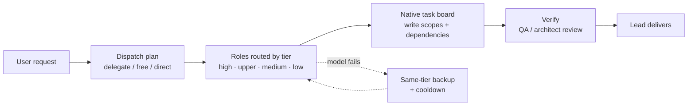

# AIWUK Team for DSH

**Your AI team, each doing what it is best at: expensive models only take hard work, and one failing model never stops the team.**

[](https://github.com/walke2019/dsh-capability-team/actions/workflows/ci.yml)


**English** | [简体中文](README.zh-CN.md)

A multi-agent team preset for DeepSeek Harness (DSH). It is a thin enhancement layer on top of the official DSH Agent Teams (the `agentTeams` service, the `team_task_*` board, `spawn_teammate` / `send_message`), not a replacement for them.

<!-- TODO: docs/assets/demo.gif — lead dispatches, a model is unplugged, same-tier backup takes over -->

## Why

- **Every teammate runs on your most expensive model → each role is routed to its own capability tier.** Architecture and review go to high/upper-tier models, docs and simple chores to cheaper ones. Teammates never inherit the lead's model, and a role with no qualifying model fails closed instead of silently borrowing one.
- **One provider outage or exhausted quota stalls the whole team → same-tier failover keeps it running.** After retries, the request moves to a configured backup of the same tier (never a cross-tier downgrade); auth and quota errors switch immediately, and failed routes cool down exponentially before returning.
- **Agents improvise, overwrite each other and burn tokens → a plan-first, board-driven workflow.** Every request starts with a dispatch plan (delegate / free / direct), subtasks land on the native task board with write scopes, and token discipline keeps prompts cacheable and outputs trimmed.

## Quick start

Requirements: DSH >= 0.2.2-rc.1 (below 0.3.0), Node.js >= 22, and the official `@deepseek-ai/dsh-experimental-agent-team-profile` bundle enabled in your DSH profile.

**1. Install**

```bash
dsh plugin add @aiwuk/team
# optional companion packages
dsh plugin add @aiwuk/search
dsh plugin add @aiwuk/memory
dsh plugin add @aiwuk/autocomplete
```

**2. Enable Agent Teams from the onboarding card**

If the official Agent Teams bundle is not enabled, an onboarding card detects it and enables it only after you click the button. Note that this affects every session in the profile and disables DSH's native generic subagent tools. The card also shows which capabilities matched a model tier. If some cannot be matched, add a provider, or ask the lead to turn on single-model mode: roles without a match then use your DSH default model, after you confirm it in a dialog.

> If the card reports that this connection cannot manage plugins, enable `@deepseek-ai/dsh-experimental-agent-team-profile` on DSH's Plugins page instead, and restart DSH if asked.

**3. Start a team session**

New session → choose the **Capability Team** preset (`capability-team`) → ask:

```text
Read the team configuration
```

The lead reports the roster, the tier of each role and which of your models were matched.

## Comparison

| | Single agent | Official DSH Agent Teams | This preset |
|---|---|---|---|
| Team lifecycle, messaging, task board | — | ✅ | ✅ (reuses the official ones) |
| Per-role model routing | — | No per-role choice; all teammates use the profile's spawn provider | ✅ Tier-based, auto-matched from your models; fails closed |
| Same-tier failover | — | — | ✅ With exponential cooldown, no cross-tier downgrade |
| Cost controls / budgets | — | Usage projections | ✅ Tier routing, per-role token budgets, token discipline |
| Dispatch triage | — | — | ✅ `delegate` / `free` / `direct` dispatch plan |
| Write-scope enforcement | — | — | ✅ Per-task `write_scopes`, per-role path/tool/sandbox policy |
| Workbench | — | Team UI | ✅ Overview, board, usage, model management, pixel office stage |

See [docs/comparison.md](docs/comparison.md) for a longer comparison, including generic model-routing plugins.

## How it works



- **Capability tiers.** Models registered in your DSH catalog are graded `high` / `upper` / `medium` / `low` by vendor naming rules; non-chat, free/trial and below-floor models are excluded. Each capability gets a primary and up to three same-tier backups.
- **Per-role routing.** Every role (capability) has its own tier and vendor preference. Unassigned roles fail closed.
- **Failover.** Same-route retries first, then the next same-tier backup. Failed routes cool down (doubling, capped at 30 minutes) and the primary returns after recovery. Auth and quota errors skip straight to the next backup.
- **Dispatch and board.** The lead must call `capability_dispatch_plan` first; delegated subtasks become board tasks with `write_scopes` and `blocked_by`, and edits outside a held task's scopes are rejected.
- **Guardrails.** Per-role sandbox / tool / path access, optional plan-first approval, session rotation with handoff, and token discipline (stable prompt prefix, output trimming, idle compaction).
- **Workbench and memory.** A live right-side panel shows the team overview, board, usage and model management with a pixel office stage; a local memory hub recalls past pitfalls and decisions for new tasks.

## Configuration

Most settings are changed by asking the lead (the change is validated and shown in DSH's confirmation dialog before it is saved) or from the workbench. Tools: `capability_team_read`, `capability_team_save`, `capability_team_import`.

```json
{ "capabilities": { "writer": { "tier": "low", "search": false } } }
```

Integrations (search, transcription, embeddings, shared memory) are read from `integrations.json` in `~/.dsh/capability-team-themes/` (`%USERPROFILE%/.dsh/capability-team-themes/` on Windows; override the directory with `CAPABILITY_TEAM_HOME`), host environment variables, or the DSH credential store. Never put literal keys in configuration — only environment variable names such as `OMNI_SEARCH_API_KEY`.

Visual settings pages for the companion packages are on DSH's **Plugins** page (open the plugin's entry; the Team page links to them):

- **Secrets are write-only**: keys show a state only (Not set / Set / Managed) and can be Set, Replaced or Cleared, never read back. They live in DSH's credential store.
- **Mothership lock badges**: settings managed by an AIWUK Mothership show "Managed by AIWUK Mothership" (locked) or "Default from Mothership" (editable).
- **Web-search provider toggle** (AIWUK Search page): "Use AIWUK Search for DSH web search" selects `aiwuk-search` for DSH's native `web_search`; turning it off restores DSH's default.

Search, Memory and Autocomplete setup (Mothership-managed vs. standalone, with an AI-agent checklist): [docs/standalone-setup.md](docs/standalone-setup.md). Full reference: [docs/configuration.md](docs/configuration.md) — tiers and auto-matching, permissions, budgets, plan-first, dispatch workflow, failover and long context, rotation, memory, and all environment variables.

## Roster and themes

The default roster is neutral:

| Role id | Capability | Default tier |
|---|---|---|
| `lead` | orchestrator | high |
| `architect` | technical-director | upper |
| `backend` | backend | upper |
| `frontend` | frontend | medium |
| `researcher` | research (read-only) | medium |
| `writer` | writer (docs paths only) | low |
| `qa` | qa | upper |

Names, duties, tiers and models can be changed per project. The former Three Kingdoms roster is an optional built-in theme: ask the lead to apply theme `three-kingdoms` (`capability_team_import { theme: "three-kingdoms" }`) and switch back with theme `default`. Projects saved with 3.x that renamed or removed hero ids keep their hero roster.

## Companion packages

| Package | What it adds |
|---|---|
| [`@aiwuk/search`](packages/omni-search/README.md) | `omni_search`, `omni_fetch`, `omni_search_providers`, `omni_transcribe` for all sessions. Vendor-neutral engines (Tavily, Brave, SearXNG, custom gateway) with failover; fetch works keyless via Jina Reader. |
| [`@aiwuk/memory`](packages/global-memory/README.md) | Explicit memory tools and bounded automatic recall. Local by default; optional OpenAI-compatible embeddings and an OpenViking shared backend. |
| [`@aiwuk/autocomplete`](packages/autocomplete/README.md) | Composer autocomplete for DSH Web: inline continuation while typing and next-message suggestions, accepted with Tab and never sent automatically. Follows the session model or a fixed low-latency model. |

All are independent profile bundles: they also work outside team sessions, and the team plugin's memory hub reads the same memory and search configuration.

## Migration

**To AIWUK (5.0.0 / 1.0.0).** The packages are now published under the `@aiwuk` scope; Loader ids, tool names, credential variables and data directories are unchanged, so your configuration carries over. Steps and rollback: [docs/migration-aiwuk.md](docs/migration-aiwuk.md).

**From 3.x.** 4.0.0 contains breaking changes: the packages were renamed and the default roster is now neutral. Update profile, bundle-list and `cordis.patch.yml` references, then see [CHANGELOG.md](CHANGELOG.md) for details. The older `cpa-tools` → `omni-search` rename is covered in [docs/configuration.md](docs/configuration.md#migration-from-cpa-tools).

## Roadmap

- Public benchmark report (cost and completion versus a single agent) — coming.
- Team templates for common project types.
- Mothership: multi-machine management — coming later.

## Contributing

For macOS desktop instances using the AIWUK Mothership connector, see [managed desktop restart](docs/macos-desktop-restart.md). This optional deployment adapter preserves the native connector protocol and restarts the full desktop app through a local supervisor.

Issues and pull requests are welcome; please use the [issue templates](.github/ISSUE_TEMPLATE) and the [pull request template](.github/PULL_REQUEST_TEMPLATE.md). Read the [development guide](docs/development.md) and the repository rules in [AGENTS.md](AGENTS.md) first. Before submitting, run `npm test`, `npm run lint` and `npm run build`.

## License

MIT. See [LICENSE](LICENSE).
