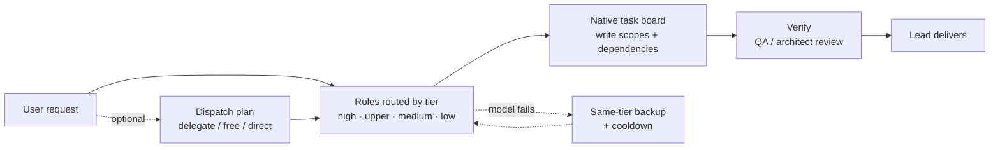

# AIWUK Team for DSH

**Your AI team, each doing what it is best at: expensive models only take hard work, and one failing model never stops the team.**

[](https://github.com/walke2019/dsh-capability-team/actions/workflows/ci.yml)


**English** | [简体中文](README.zh-CN.md)

A multi-agent team preset for DeepSeek Harness (DSH). It is a thin enhancement layer over official collaboration: rc.1 uses experimental Agent Teams; rc.2 uses native subagent trees and the `agentTeams` task board. It does not replace native identities, execution, permissions or approvals.

<!-- TODO: docs/assets/demo.gif — lead dispatches, a model is unplugged, same-tier backup takes over -->

## Why

- **Every teammate runs on your most expensive model → each role is routed to its own capability tier.** Architecture and review go to high/upper-tier models, docs and simple chores to cheaper ones. Teammates never inherit the lead's model, and a role with no qualifying model fails closed instead of silently borrowing one.
- **One provider outage or exhausted quota stalls the whole team → same-tier failover keeps it running.** After retries, the request moves to a configured backup of the same tier (never a cross-tier downgrade); auth and quota errors switch immediately, and failed routes cool down exponentially before returning.
- **Keep the team features without a second execution framework.** Role naming, canvas synchronization, model routing/failover, memory, status and token usage remain available. Dispatch enforcement, budgets, rotation and additional file/token rules are opt-in; `workflow.mode=off` preserves native execution.

## Quick start

Requirements: DSH >= 0.2.2-rc.1 (below 0.3.0) and Node.js >= 24.9. Team 5.3.0 supports the two verified native contracts below; the version range alone is not proof of compatibility with every future build.

| Native contract | rc.1 | rc.2 |
| --- | --- | --- |
| Composition | Enable `@deepseek-ai/dsh-experimental-agent-team-profile` | Team board and subagent services are in native base; no legacy bundle is needed |
| Create a named role | `spawn_teammate` (`context=fresh/fork`) | `subagent` / `subagent_fork`, with explicit registered role `name` |
| Message / interrupt target | `target` | `agent` (native full path for nested agents) |
| Wait | Native rc.1 team wait; teammates end an idle turn | Native input wait with `timeout_ms`; rc.1 teammate-wait restrictions are not imposed |
| Identity / board | Native team roster and task board | Native subagent root/path identity and task DAG; no plugin-owned roster |

Unknown or unnamed AIWUK roles fail closed before native creation; use the registered internal role ID. Standard-preset delegation is unchanged. The rc.2 native task-board mode remains user-selected; installing this preset does not silently enable it.

**1. Install**

```bash
dsh plugin add @aiwuk/team
# optional companion packages
dsh plugin add @aiwuk/search
dsh plugin add @aiwuk/memory
dsh plugin add @aiwuk/autocomplete
```

**2. Enable Agent Teams from the onboarding card**

On rc.1, the onboarding card can enable the official experimental bundle only after your click. That legacy bundle affects the whole profile and replaces generic subagent tools. On rc.2, the card reports native collaboration instead: it neither enables the removed bundle nor disables native `subagent` / `subagent_fork`. Use DSH's own control to select task-board mode when needed.

The card also shows capability-to-model coverage. Add a provider for unmatched capabilities, or explicitly enable single-model mode after user confirmation. With the default `confirmDispatch=on-change`, the existing primary/fallback card appears for the first role and changed routes, after native approval/guards and before creation. Cancel means no child is created. Existing explicit `never` is preserved; `always` is also available. Confirmation is not an authentication, quota or live-model health check.

> On rc.1 only, if this connection cannot manage plugins, enable `@deepseek-ai/dsh-experimental-agent-team-profile` on DSH's Plugins page and follow any restart request.

**3. Start a team session**

New session → choose the **Capability Team** preset (`capability-team`) → ask:

```text
Read the team configuration
```

The lead reports the roster, the tier of each role and which of your models were matched.

## Verification boundary for 5.3.0

The pre-release dual-runtime gate passed 867 checks per generation (865 passed, two Desktop-ASAR cases skipped), with real native provider preparation/lifecycle and Cordis injection checks, rc.1/rc.2 smoke checks, lint and build. These results do not establish real gateway authentication, billing/quota availability, browser GUI acceptance or the skipped Desktop-ASAR behavior. Final package validation is a separate release gate; source tests do not mean an installed instance was updated.

The companion `@aiwuk/memory` 1.0.6 restores ordinary-preset memory on rc.2 by checking the current native composition, without the removed team-membership API. Capability-team compositions retain their own memory tools; explicitly selected standard children may use global memory.

## Comparison

| | Single agent | Official DSH Agent Teams | This preset |
|---|---|---|---|
| Team lifecycle, messaging, task board | — | ✅ | ✅ (reuses the official ones) |
| Per-role model routing | — | No per-role choice; all teammates use the profile's spawn provider | ✅ Tier-based, auto-matched from your models; fails closed |
| Same-tier failover | — | — | ✅ With exponential cooldown, no cross-tier downgrade |
| Cost controls / budgets | — | Usage projections | ✅ Tier routing and usage; explicit per-role budgets and optional token discipline |
| Dispatch triage | — | — | ✅ `delegate` / `free` / `direct` dispatch plan |
| Write-scope enforcement | — | — | ✅ Per-task `write_scopes`, per-role path/tool/sandbox policy |
| Workbench | — | Team UI | ✅ Overview, board, usage, model management, pixel office stage |

See [docs/comparison.md](docs/comparison.md) for a longer comparison, including generic model-routing plugins.

## How it works



- **Capability tiers.** Models registered in your DSH catalog are graded `high` / `upper` / `medium` / `low` by vendor naming rules; non-chat, free/trial and below-floor models are excluded. Each capability gets a primary and up to three same-tier backups.
- **Per-role routing.** Every role (capability) has its own tier and vendor preference. Unassigned roles fail closed. With `confirmDispatch: "on-change"` (the new default) or `"always"`, Lead spawns reuse the existing primary/backup model card after native approval and guards, before member creation. `on-change` asks on the first spawn for a role and again when its route changes; `always` asks each time. Canceling the card creates no member. Explicit `"never"` retains the static role/model, provider-registration and cooldown preflight on the native permission `allow` path; `ask` is passed through without rerunning that preflight after approval. Readiness or member creation does not prove authentication, quota or an LLM response; the first model request still fails closed against unavailable routes.
- **Failover.** Same-route retries first, then the next same-tier backup. Failed routes cool down (doubling, capped at 30 minutes); a healthy backup stays selected during the activity, rather than switching back solely because a timer expired. New owner input or a route/lease change starts a fresh selection boundary. Auth and quota errors skip straight to the next backup.
- **Native-first collaboration.** Dispatch enforcement is off by default. Use the official team tools directly; `capability_dispatch_plan` remains optional. Explicit `workflow.mode: "enforce"` requires a plan. Task-scope enforcement, rotation, extra file rules and token discipline are independent opt-ins; role-model confirmation is independent of dispatch enforcement.
- **Safety and optional policies.** Native sandbox, approval and file-observation rules remain active. Explicit role access, `planFirst` and `maxTokens` settings are preserved; disabling dispatch enforcement grants no new authority.
- **Workbench and memory.** A live right-side panel shows the team overview, board, usage and model management with a pixel office stage; a local memory hub recalls past pitfalls and decisions for new tasks. Member cards, running counts and the canvas share native session-status data; unknown status stays unknown while synchronizing, not idle. In-progress tasks and catalog residency are not running-member counts.

## Configuration

Most settings are changed by asking the lead (the change is validated and shown in DSH's confirmation dialog before it is saved) or from the workbench. Tools: `capability_team_read`, `capability_team_save`, `capability_team_import`.

Unset policy fields use native-first defaults: `workflow.mode: "off"`, `confirmDispatch: "on-change"`, and `enforceWriteScopes`, `fileLimits`, `rotation`, `tokens` set to `false`. Existing explicit values, including `confirmDispatch: "never"` and legacy `enforce`, remain effective; loading does not rewrite stored configuration. Role names, canvas synchronization, role models and automatic failover, memory, status and token usage remain enabled independently. Canvas state is derived from native live projections, not a separate execution state machine.

```json
{ "capabilities": { "writer": { "tier": "low", "search": false } } }
```

Integrations (search, transcription, embeddings, shared memory) are read from `integrations.json` in `~/.dsh/capability-team-themes/` (`%USERPROFILE%/.dsh/capability-team-themes/` on Windows; override the directory with `CAPABILITY_TEAM_HOME`), host environment variables, or the DSH credential store. Never put literal keys in configuration — only environment variable names such as `OMNI_SEARCH_API_KEY`.

Visual settings pages for the companion packages are on DSH's **Plugins** page (open the plugin's entry; the Team page links to them):

- **Secrets are write-only**: keys show a state only (Not set / Set / Managed) and can be Set, Replaced or Cleared, never read back. They live in DSH's credential store.
- **Mothership lock badges**: settings managed by an AIWUK Mothership show "Managed by AIWUK Mothership" (locked) or "Default from Mothership" (editable).
- **Web-search provider toggle** (AIWUK Search page): "Use AIWUK Search for DSH web search" selects `aiwuk-search` for DSH's native `web_search`; turning it off restores DSH's default.

Search, Memory and Autocomplete setup (Mothership-managed vs. standalone, with an AI-agent checklist): [docs/standalone-setup.md](docs/standalone-setup.md). Full reference: [docs/configuration.md](docs/configuration.md) — tiers and auto-matching, permissions, budgets, plan-first, dispatch workflow, failover and long context, rotation, memory, and all environment variables.

## Roster and themes

The default roster is neutral:

| Role id | Capability | Default tier |
|---|---|---|
| `lead` | orchestrator | high |
| `architect` | technical-director | upper |
| `backend` | backend | upper |
| `frontend` | frontend | medium |
| `researcher` | research (read-only) | medium |
| `writer` | writer (docs paths only) | low |
| `qa` | qa | upper |

Names, duties, tiers and models can be changed per project. The former Three Kingdoms roster is an optional built-in theme: ask the lead to apply theme `three-kingdoms` (`capability_team_import { theme: "three-kingdoms" }`) and switch back with theme `default`. Projects saved with 3.x that renamed or removed hero ids keep their hero roster.

## Companion packages

| Package | What it adds |
|---|---|
| [`@aiwuk/search`](packages/omni-search/README.md) | `omni_search`, `omni_fetch`, `omni_search_providers`, `omni_transcribe` for all sessions. Vendor-neutral engines (Tavily, Brave, SearXNG, custom gateway) with failover; fetch works keyless via Jina Reader. |
| [`@aiwuk/memory`](packages/global-memory/README.md) | Explicit memory tools and bounded automatic recall. Local by default; optional OpenAI-compatible embeddings and an OpenViking shared backend. |
| [`@aiwuk/autocomplete`](packages/autocomplete/README.md) | Composer autocomplete for DSH Web: inline continuation while typing and next-message suggestions, accepted with Tab and never sent automatically. Follows the session model or a fixed low-latency model. |

All are independent profile bundles: they also work outside team sessions, and the team plugin's memory hub reads the same memory and search configuration.

## Migration

**To AIWUK (5.0.0 / 1.0.0).** The packages are now published under the `@aiwuk` scope; Loader ids, tool names, credential variables and data directories are unchanged, so your configuration carries over. Steps and rollback: [docs/migration-aiwuk.md](docs/migration-aiwuk.md).

**From 3.x.** 4.0.0 contains breaking changes: the packages were renamed and the default roster is now neutral. Update profile, bundle-list and `cordis.patch.yml` references, then see [CHANGELOG.md](CHANGELOG.md) for details. The older `cpa-tools` → `omni-search` rename is covered in [docs/configuration.md](docs/configuration.md#migration-from-cpa-tools).

## Roadmap

- Public benchmark report (cost and completion versus a single agent) — coming.
- Team templates for common project types.
- Mothership: multi-machine management — coming later.

## Contributing

For macOS desktop instances using the AIWUK Mothership connector, see [managed desktop restart](docs/macos-desktop-restart.md). This optional deployment adapter preserves the native connector protocol and restarts the full desktop app through a local supervisor.

Issues and pull requests are welcome; please use the [issue templates](.github/ISSUE_TEMPLATE) and the [pull request template](.github/PULL_REQUEST_TEMPLATE.md). Read the [development guide](docs/development.md) and the repository rules in [AGENTS.md](AGENTS.md) first. Before submitting, run `npm test`, `npm run lint` and `npm run build`.

## License

MIT. See [LICENSE](LICENSE).
