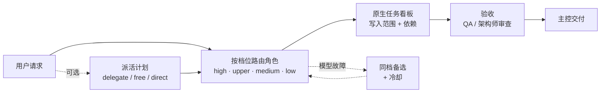

# DSH AI悟空 协作团队

**你的 AI 团队，各展所长：贵的模型只干难活，一个模型挂了团队照常运转。**

[](https://github.com/walke2019/dsh-capability-team/actions/workflows/ci.yml)


[English](README.md) | **简体中文**

面向 DeepSeek Harness（DSH）的多智能体团队预设。它是构建在官方 DSH Agent Teams（`agentTeams` 服务、`team_task_*` 看板、`spawn_teammate` / `send_message`）之上的一层轻量增强，而不是替代品。

<!-- TODO: docs/assets/demo.gif — lead dispatches, a model is unplugged, same-tier backup takes over -->

## 为什么需要它

- **每个队友都在用你最贵的模型 → 每个角色按能力档位路由。** 架构与审查交给 high/upper 档模型，文档和简单杂活交给更便宜的模型。队友不会继承主控的模型；没有合格模型的角色直接 fail-closed，绝不悄悄借用别的模型。
- **一个渠道宕机或额度耗尽，整个团队卡住 → 同档容灾让团队继续运转。** 重试之后，请求切换到已配置的同档备选（绝不跨档降级）；鉴权与额度错误立即切换，故障路由按指数冷却后再恢复。
- **智能体各自乱干、互相覆盖、浪费 Token → 计划先行、看板驱动的工作流。** 每个请求先出派活计划（delegate / free / direct），子任务带写入范围进入原生任务看板，Token 纪律保证提示词可缓存、输出被裁剪。

## 快速开始

前置条件：DSH >= 0.2.2-rc.1（且 < 0.3.0）、Node.js >= 24.9，并在 DSH profile 中启用官方 `@deepseek-ai/dsh-experimental-agent-team-profile` bundle。

**1. 安装**

```bash
dsh plugin add @aiwuk/team
# 可选的配套包
dsh plugin add @aiwuk/search
dsh plugin add @aiwuk/memory
dsh plugin add @aiwuk/autocomplete
```

**2. 在引导卡片中启用 Agent Teams**

如果官方 Agent Teams bundle 未启用，引导卡片会检测到，只有你点击按钮后才会启用。注意：启用后会影响该 profile 下的所有会话，并停用 DSH 原生的通用子智能体工具。卡片还会显示哪些能力已匹配到模型档位。如果有能力匹配不到，可以补充渠道，或让主控开启单模型模式：未匹配的角色改用你的 DSH 默认模型，开启前会弹出确认框由你确认。

> 如果卡片提示当前连接不能管理插件，请在 DSH 的“插件”页手动启用 `@deepseek-ai/dsh-experimental-agent-team-profile`，并按提示重启 DSH。

**3. 开始团队会话**

新建会话 → 选择 **能力协作团队** 预设（`capability-team`）→ 输入：

```text
读取团队配置
```

主控会汇报名册、各角色的档位以及匹配到了你的哪些模型。

## 对比

| | 单智能体 | 官方 DSH Agent Teams | 本预设 |
|---|---|---|---|
| 团队生命周期、消息、任务看板 | — | ✅ | ✅（复用官方能力） |
| 按角色模型路由 | — | 不能按角色选模型，所有队友走 profile 配置的同一派生通道 | ✅ 按档位从你的模型自动匹配；未分配即 fail-closed |
| 同档容灾 | — | — | ✅ 指数冷却，绝不跨档降级 |
| 成本控制 / 预算 | — | 用量投影 | ✅ 档位路由与用量；显式角色预算及可选 Token 纪律 |
| 派活分流 | — | — | ✅ `delegate` / `free` / `direct` 派活计划 |
| 写入范围强制 | — | — | ✅ 按任务 `write_scopes`，按角色路径/工具/沙箱策略 |
| 工作台 | — | 团队 UI | ✅ 总览、看板、用量、模型管理、像素办公室舞台 |

更完整的对比（包括通用模型路由类插件）见 [docs/comparison.zh-CN.md](docs/comparison.zh-CN.md)。

## 工作原理



- **能力档位。** DSH 目录中已注册的模型按厂商命名规则分为 `high` / `upper` / `medium` / `low`；非对话、免费/试用及低于版本下限的模型会被排除。每个能力获得一个主模型和最多三个同档备选。
- **按角色路由。** 每个角色（能力）有自己的档位与厂商偏好。未分配模型的角色 fail-closed。`confirmDispatch: "on-change"`（新默认）或 `"always"` 下，主控创建队友在原生审批和守卫通过后、创建成员前复用现有主备模型选择卡；`on-change` 在首次创建该角色或路由变化时询问，`always` 每次询问，取消卡片不创建成员。显式 `"never"` 保留原生权限 `allow` 分支的角色/模型、提供方注册及冷却静态预检查；`ask` 原样交给原生审批，通过后不重跑该预检查。静态就绪或创建成功不代表认证、额度或 LLM 响应成功；首次模型请求仍对不可用路由 fail-closed。
- **容灾。** 先在同一路由重试，再切换到下一个同档备选。故障路由进入冷却（逐次加倍，上限 30 分钟）；同一活动内保持健康备用，不因定时器到期就回切。新用户输入或路由/租约变更构成重新选路边界。鉴权与额度错误直接跳到下一个备选。
- **原生优先协作。** 默认不强制派活计划，直接使用官方团队工具；`capability_dispatch_plan` 仍可手动调用。仅显式设置 `workflow.mode: "enforce"` 才要求计划。任务写入范围强制、轮换、附加文件规则与 Token 纪律分别按配置启用；角色模型确认独立于强制派工。
- **安全与可选策略。** 原生沙箱、审批和文件观察规则持续生效。显式角色权限、`planFirst` 与 `maxTokens` 配置继续保留；关闭强制派工不授予任何新权限。
- **工作台与记忆。** 右侧实时面板展示团队总览、看板、用量与模型管理，并带像素办公室舞台；本地记忆枢纽在新任务时召回过去的踩坑与决策。成员卡片、运行人数与画布同源使用原生会话状态；未知状态在同步时仍为未知，不当作空闲。进行中的任务数与目录中的驻留状态都不等于运行成员数。

## 配置

大多数设置可以直接让主控修改（修改经校验，并在 DSH 确认对话框中展示差异后才保存），也可在工作台中操作。相关工具：`capability_team_read`、`capability_team_save`、`capability_team_import`。

未设置的策略字段采用原生优先默认：`workflow.mode: "off"`、`confirmDispatch: "on-change"`，`enforceWriteScopes`、`fileLimits`、`rotation`、`tokens` 均为 `false`。已有显式值（包括 `confirmDispatch: "never"` 与旧的 `enforce`）继续生效，读取配置不会改写存储。角色命名、画布同步、角色模型及自动回退、记忆、状态与 token 用量独立保留；画布由原生实时投影派生，不另建执行状态机。

```json
{ "capabilities": { "writer": { "tier": "low", "search": false } } }
```

集成（搜索、转写、嵌入、共享记忆）从 `~/.dsh/capability-team-themes/` 下的 `integrations.json`（Windows 为 `%USERPROFILE%/.dsh/capability-team-themes/`，可用 `CAPABILITY_TEAM_HOME` 覆盖目录）、Host 环境变量或 DSH 凭据库读取。配置中绝不写密钥本身，只写环境变量名，例如 `OMNI_SEARCH_API_KEY`。

配套包的可视化设置页位于 DSH 的“插件”页（打开对应插件条目；团队页提供入口说明）：

- **密钥只写不读**：密钥只显示状态（未设置 / 已设置 / 由母舰托管），可设置、替换或清除，但永远不会回显。密钥保存在 DSH 凭据库中。
- **母舰锁定徽标**：由 AI悟空 母舰托管的设置会显示“由 AI悟空 母舰托管”（锁定）或“母舰默认值”（可编辑）。
- **网页搜索提供方开关**（AI悟空 全能搜索页）：“让 DSH 网页搜索使用 AI悟空 全能搜索”会为 DSH 原生 `web_search` 选定 `aiwuk-search`；关闭后恢复 DSH 默认。

全能搜索、全局记忆、输入补全的配置（母舰托管与单独安装两种方式，含给 AI 智能体的配置指引）：[docs/standalone-setup.zh-CN.md](docs/standalone-setup.zh-CN.md)。完整参考：[docs/configuration.zh-CN.md](docs/configuration.zh-CN.md) —— 档位与自动匹配、权限、预算、计划先行、派活工作流、容灾与长上下文、轮换、记忆以及全部环境变量。

## 名册与主题

默认名册为中性角色：

| 角色 id | 能力 | 默认档位 |
|---|---|---|
| `lead` | orchestrator | high |
| `architect` | technical-director | upper |
| `backend` | backend | upper |
| `frontend` | frontend | medium |
| `researcher` | research（只读） | medium |
| `writer` | writer（仅文档路径） | low |
| `qa` | qa | upper |

名称、职责、档位和模型都可按项目修改。原先的三国名册现在是可选的内置主题：让主控应用主题 `three-kingdoms`（`capability_team_import { theme: "three-kingdoms" }`），用主题 `default` 切回。3.x 保存的项目若改名或删除了英雄 id，会保留其英雄名册。

## 配套包

| 包 | 提供的能力 |
|---|---|
| [`@aiwuk/search`](packages/omni-search/README.md) | 为所有会话提供 `omni_search`、`omni_fetch`、`omni_search_providers`、`omni_transcribe`。厂商中立的引擎（Tavily、Brave、SearXNG、自定义网关）自动故障切换；抓取经 Jina Reader 免密钥可用。 |
| [`@aiwuk/memory`](packages/global-memory/README.md) | 显式记忆工具与有界自动召回。默认纯本地；可选 OpenAI 兼容嵌入与 OpenViking 共享后端。 |
| [`@aiwuk/autocomplete`](packages/autocomplete/README.md) | DSH Web 输入框自动补全：打字停顿时行内续写、回复后建议下一句，按 Tab 采纳、绝不自动发送。可跟随会话模型或固定一个低延迟模型。 |

它们都是独立的 profile bundle：在团队会话之外同样可用，团队插件的记忆枢纽读取同一份记忆与搜索配置。

## 迁移

**迁移到 AI悟空（5.0.0 / 1.0.0）。** 包已改发布到 `@aiwuk` 作用域；Loader id、工具名、凭据变量与数据目录均不变，原有配置会沿用。步骤与回滚见 [docs/migration-aiwuk.md](docs/migration-aiwuk.md)。

**从 3.x 迁移。** 4.0.0 包含破坏性变更：包已改名，默认名册改为中性角色。请更新 profile、bundle 列表和 `cordis.patch.yml` 中的引用，详情见 [CHANGELOG.md](CHANGELOG.md)。更早的 `cpa-tools` → `omni-search` 改名见 [docs/configuration.zh-CN.md](docs/configuration.zh-CN.md)。

## 路线图

- 公开基准测试报告（与单智能体对比成本与完成度）—— 即将发布。
- 面向常见项目类型的团队模板。
- Mothership：多机管理 —— 稍后推出。

## 参与贡献

macOS 桌面实例接入 AIWUK 中枢后，可按[桌面托管重启说明](docs/macos-desktop-restart.md)安装可选部署适配器；它复用连接器原生协议，通过本机监督器重启整个桌面应用。

欢迎提交 Issue 和 Pull Request，请使用 [Issue 模板](.github/ISSUE_TEMPLATE) 和 [PR 模板](.github/PULL_REQUEST_TEMPLATE.md)。请先阅读[开发指南](docs/development.zh-CN.md)和仓库规范 [AGENTS.md](AGENTS.md)。提交前运行 `npm test`、`npm run lint` 和 `npm run build`。

## 许可

MIT，详见 [LICENSE](LICENSE)。
